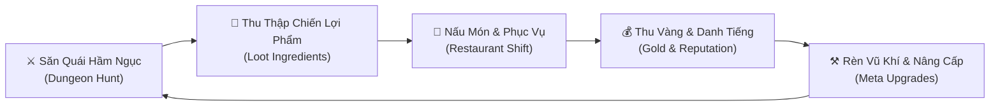

# 🎮 DUNGEON EATER — TỔNG QUAN DỰ ÁN GAME

> **Báo Cáo Bài Tập Lớn Môn: Thiết Kế Và Phát Triển Game**  
> **Trường Đại Học Thủy Lợi — Khoa Công Nghệ Thông Tin**  
> **Giáo viên hướng dẫn:** ThS. Trương Xuân Nam  
> **Lớp:** 65CNTT — Hà Nội, 2026  

---

## 👥 Nhóm Sinh Viên Thực Hiện (DungeonEater Team)

| STT | Mã Sinh Viên | Họ và Tên | Vai Trò / Nhiệm Vụ |
|:---:|:---:|:---|:---|
| 1 | **2351060441** | **Nguyễn Văn Hải** | Trưởng nhóm, Ý tưởng High Concept, Game Overview, Thiết kế hệ thống |
| 2 | **2351060445** | **Nguyễn Minh Hiệp** | Ý tưởng High Concept, Thiết kế Gameplay & Mechanics, Cân bằng Game |
| 3 | **2351060444** | **Ngô Văn Hiến** | Cốt truyện & Nhân vật, Xây dựng Level Design & Môi trường |
| 4 | **2351060443** | **Trần Hữu Hậu** | Giao diện người dùng UI/UX, Hệ thống Âm thanh & Quản lý Asset |

---

## 🌟 1. High Concept & Thể Loại (Game Overview)

* **Tên Game:** Dungeon Eater
* **Thể loại (Genre):** Action Roguelite / Hack & Slash kết hợp Restaurant Management (Quản lý nhà hàng).
* **Góc nhìn (Perspective):** Top-down 2D.
* **Phong cách đồ họa (Visual Style):** 2D Pixel Art cổ điển giả tưởng (Fantasy Dark & Cozy Tavern).
* **Nền tảng phát triển:** Unity Engine (C#).

### 💡 Ý Tưởng Cốt Lõi (High Concept)
Nhập vai một thợ săn vô danh tỉnh giấc giữa hầm ngục tăm tối. Sau khi hạ gục quái vật và tình cờ phát hiện thịt của chúng thơm ngon kỳ lạ, nhân vật bước ra ngoài và bắt tay cùng Trưởng làng Dun để biến một căn nhà hoang thành quán ăn ẩm thực quái thú — vừa chiến đấu sinh tồn thu thập nguyên liệu quý hiếm, vừa nấu nướng phục vụ thực khách để tái đầu tư nâng cấp quán ăn lẫn trang bị thợ săn.

### 🔄 Vòng Lặp Cốt Lõi (Core Gameplay Loop)


---

## 📖 2. Cốt Truyện & Thế Giới Game (Story & Lore)

1. **Thức tỉnh trong bóng tối:**  
   Bạn là một con người vô danh, không còn ký ức về quá khứ, tỉnh dậy giữa lòng hầm ngục cổ ngữ âm u với cảm giác đói cào ruột gan. Trên lưng bạn trang bị sẵn một thanh kiếm và một cây cung — những vũ khí mang lại cảm giác thân thuộc kỳ lạ.
2. **Khám phá ẩm thực quái vật:**  
   Để sinh tồn qua các đợt quái hung dữ, trong cơn đói cùng cực, bạn đã nướng thử thịt quái vật rơi ra và kinh ngạc phát hiện chúng mang hương vị thơm ngon và dồi dào sinh lực chưa từng thấy.
3. **Ngôi làng Dun mất mùa:**  
   Tìm được đường ra khỏi hầm ngục, bạn bắt gặp làng Dun — một ngôi làng hẻo lánh vừa trải qua đợt mất mùa nghiêm trọng do quái vật tràn ra tàn phá. Người dân đói ăn nhưng không ai đủ tiền mua thịt quái.
4. **Giao kèo với Trưởng Làng:**  
   Trưởng Làng Dun đã đại diện người dân ngỏ ý đổi căn nhà gỗ bỏ hoang đầu làng lấy số lương thực quý của bạn. Bạn đồng ý, và hành trình gây dựng quán ăn "Dungeon Eater" chính thức bắt đầu!

---

## ⚔️ 3. Cơ Chế Chiến Đấu & Vũ Khí (Combat Mechanics)

Hệ thống chiến đấu tập trung vào nhịp độ nhanh, phản xạ né tránh và cảm giác lực (hit-feedback) sắc bén:

* **Di chuyển:** 8 hướng mượt mà kết hợp ngắm bắn chuột 360°.
* **Lướt né đòn (Dash):** Tốc độ cao kèm khung bất tử (**i-frame**) giúp né đòn quét diện rộng.
* **Hệ thống Vũ khí Linh hoạt (Chuyển đổi tức thì):**
  * 🗡️ **Thanh Kiếm Sắt (Cận chiến):** Combo 3 nhát chém chém vệt xanh, đòn chém quét hình vòng cung rộng (**Cleave**), và tuyệt chiêu Lốc Xoáy (**Whirlwind**) xoay 360° càn quét đám đông.
  * 🏹 **Cây Cung Gỗ (Tầm xa):** Bắn tên nhanh tầm xa (**Quick Shot**), giương cung gồng lực (**Charged Shot**), và kỹ năng Mũi Tên Xuyên Thấu (**Piercing Magic Arrow**) bắn xuyên mọi mục tiêu trên một đường thẳng.
* **Cảnh báo đòn đánh (Telegraph):** Toàn bộ kỹ năng nguy hiểm của quái và Boss đều có cảnh báo trước 0.35s – 0.6s để người chơi phản xạ.

---

## 👾 4. Hệ Thống Quái Vật & Boss Cuối

| Quái vật / Boss | Vai trò | Đặc điểm & Hành vi chiến đấu | Chiến lợi phẩm rơi ra |
|---|---|---|---|
| **Slime Xanh** | Cận chiến | Nhảy nhún tiếp cận, vồ cắn chớp nhoáng khi áp sát | 🥩 Thịt Quái Thường (80%) |
| **Bọ Cảm Tử (Kamikaze Beetle)** | Tự sát | Di chuyển 6 chân cực nhanh, kích hoạt ngòi nổ phát sáng rồi nổ tung diện rộng | 💣 Lõi Bọ Nổ (65%) |
| **Nấm Bào Tử (Ranged Spore)** | Tầm xa | Canh khoảng cách, phập phồng hô hấp và bắn quả cầu độc bay thẳng | 🍄 Nấm Hang Sâu (75%) |
| **Vua Lợn Rừng (King Boar)** | **Boss Cuối** | Lượng máu khổng lồ, kỹ năng dậm đất nổ đá, húc càn xuyên phòng và triệu hồi bầy bọ hỗ trợ | 🍖 Sườn Boss Hoàng Kim + 150 Vàng (100%) |

---

## 🍲 5. Quản Lý Quán Ăn & Thực Khách (Restaurant System)

* **Bếp lò chế biến:** Nấu ngay các món ăn độc đáo khi tích lũy đủ nguyên liệu hầm ngục:
  1. 🍢 **Thịt xiên nướng quái thú:** 2 Thịt quái $\to$ Giá bán: **35 Vàng** (+5 Danh tiếng).
  2. 🥣 **Bát súp nấm hang sâu:** 2 Nấm hang $\to$ Giá bán: **45 Vàng** (+8 Danh tiếng).
  3. 🥩 **Bít tết bùng nổ:** 2 Thịt quái + 1 Lõi bọ nổ $\to$ Giá bán: **85 Vàng** (+15 Danh tiếng).
  4. 🍖 **Đại tiệc Vua Thú:** 1 Sườn Boss + 2 Nấm + 2 Thịt $\to$ Giá bán: **220 Vàng** (+35 Danh tiếng).
* **Hệ thống Thực khách Làng quê:** 6 loại khách đa dạng (Nông dân, Thương nhân, Mạo hiểm gia, Cô gái làng, Bà lão, Lữ khách bí ẩn).
* **Thanh kiên nhẫn (Patience Timer):** Mỗi khách hàng có độ kiên nhẫn riêng. Phục vụ đúng giờ giúp tăng danh tiếng và nhận tiền boa; phục vụ trễ khách sẽ giận dữ bỏ về.
* **Bàn ăn trực quan:** Khi món ăn được phục vụ, đĩa thức ăn thành phẩm sẽ hiển thị trực tiếp lên mặt bàn gỗ sồi.

---

## ⌨️ 6. Bảng Tra Cứu Phím Điều Khiển (Input Controls)

| Phím bấm | Chức năng trong Hầm ngục (`DungeonLevel`) | Chức năng tại Làng & Quán ăn |
|---|---|---|
| **W, A, S, D** | Di chuyển nhân vật 8 hướng | Di chuyển xung quanh làng & quán ăn |
| **Chuột Trái (LMB) / J** | Đánh thường (Combo Kiếm / Bắn Cung) | Tương tác chọn món trên giao diện UI |
| **Chuột Phải (RMB) / K** | Đòn đánh mạnh (Chém quét / Cung gồng) | Hủy chọn / Đóng menu |
| **Phím Q** | Kỹ năng vũ khí (Lốc xoáy / Tên xuyên thấu) | — |
| **Phím Cách (Space)** | Lướt né đòn thần tốc (Dash có i-frame) | — |
| **Phím Tab** | Đổi vũ khí linh hoạt (Kiếm $\leftrightarrow$ Cung) | Đổi chế độ xem nhân vật |
| **Phím F** | Nhặt nhanh chiến lợi phẩm / Bước vào Cổng Portal | Tương tác Trưởng làng, dọn bàn, nấu bếp |
| **Phím Esc** | Tạm dừng game (Pause Menu) | Đóng các cửa sổ popup |

---

## 📁 7. Cấu Trúc Dự Án Unity (Clean Architecture)

Dự án được tổ chức khoa học theo cấu trúc chuẩn mực của Unity:

```text
Game/
├── Assets/
│   ├── Animations/        # Hoạt ảnh Player (Combat/Chef), Boss King Boar, Trưởng làng Dun
│   ├── Audio/             # 13 hiệu ứng âm thanh SFX + 2 bản nhạc nền BGM (Dungeon & Tavern)
│   ├── Physics/           # Vật liệu chống kẹt góc Frictionless2D
│   ├── Prefabs/
│   │   ├── Characters/    # Prefab Thợ săn chiến đấu & Đầu bếp
│   │   ├── Customers/     # 6 nhóm khách hàng làng quê
│   │   ├── Enemies/       # Slime, Beetle, Spore, Boss King Boar
│   │   ├── Environment/   # Cổng dịch chuyển Portal ma thuật
│   │   ├── Loot/          # Thịt, Nấm, Lõi bọ, Sườn Boss (có nam châm hút)
│   │   ├── NPC/           # Trưởng Làng Dun (Village Elder)
│   │   └── VFX/           # Vệt chém kiếm, Mũi tên, Cầu độc, Vụ nổ
│   ├── Scenes/
│   │   ├── TitleScreen.unity       # Màn hình chính mở đầu (Build Index 0)
│   │   ├── DungeonLevel.unity      # Hầm ngục săn quái 3 đợt & Boss (Build Index 1)
│   │   ├── VillageLevel.unity      # Hub làng Dun kết nối cốt truyện (Build Index 2)
│   │   ├── RestaurantLevel.unity   # Quán ăn phục vụ thực khách (Build Index 3)
│   │   └── Hero.unity              # Scene kiểm thử nhân vật và chuyển view
│   ├── Scripts/           # Mã nguồn C# phân nhóm: Core, Dungeon, NPC, Restaurant, Testing, UI, Upgrades
│   └── Sprites/           # Bảng Sprite Sheet chuẩn 256x256, bản đồ môi trường, UI Kit, VFX
├── Packages/              # Danh mục Unity Package Manager
├── ProjectSettings/       # Thiết lập Physics2D, Tag, Layer, Build Settings
└── README.md
```

---

## 🚀 8. Hướng Dẫn Mở & Chạy Game Trên Unity

1. Khởi động **Unity Hub** và chọn **Add project from disk**.
2. Trỏ đến thư mục chứa dự án: `/home/jid-mie/Game` (phiên bản Unity khuyến nghị: **Unity 2022.3 LTS** trở lên).
3. Tại cửa sổ **Project**, truy cập thư mục: `Assets/Scenes/`.
4. Nhấp đúp mở Scene **`TitleScreen.unity`**.
5. Nhấn nút **▶ Play** trên thanh công cụ Unity để trải nghiệm toàn bộ luồng game từ Màn hình chính $\to$ Hầm ngục $\to$ Làng Dun $\to$ Quán ăn!

---

*© 2026 Nhóm DungeonEater — Khoa CNTT, Trường Đại Học Thủy Lợi.*
